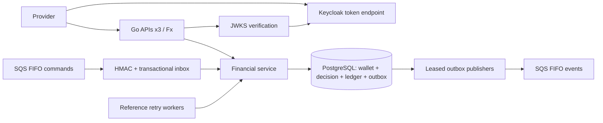

# Architecture

## Runtime composition

Uber Fx provides configuration, OIDC verifier, PostgreSQL pool, repositories,
financial service, SQS client, HTTP routes and background workers. Lifecycle hooks
load JWKS, connect/migrate PostgreSQL, resolve queues and then listen for HTTP.
Shutdown stops HTTP and workers before closing the pool.

The supported development deployment has three independent host processes on
127.0.0.1:8080, :8082 and :8083. PostgreSQL, Keycloak and LocalStack run in Docker.
There is no shared process memory and no requirement for sticky routing.

## Financial transaction

1. Validate identifiers, kind and decimal-string amount; calculate canonical SHA-256.
2. Lock the wallet row with SELECT FOR UPDATE. Validate provider-scoped idempotency
   and external transaction uniqueness. A matching replay returns persisted state.
3. Check player/currency, reference and reversal rules. Calculate using int64 cents
   with overflow detection. Insufficient funds never produce a negative balance.
4. Insert decision, update wallet/version when a movement occurs, append immutable
   ledger and outbox event. SQS calls also record inbox in this transaction.
5. Commit once. Only afterward may the message be acknowledged or the event published.

Constraints and unique indexes are the final concurrency guards. Wallet row locks
serialize balance decisions across all API/worker processes. Same keys across
providers are independent. Rejected commands are durable and replayable.

OPENING with a positive amount creates an opening record and credit; zero creates
no ledger movement. BET debits, WIN credits, LOSS requires zero and does not change
version. REFUND credits a matching processed BET. ROLLBACK reverses a processed
BET, WIN or REFUND. Reversals require equal amount, provider, wallet, player,
currency, round and game; referenced WIN may differ in amount from its BET.
Only one processed REFUND/ROLLBACK may target a reference. Rolling back a refund
does not reopen the original BET for another refund. WIN references remain optional.

## Pending references

A missing/nonterminal reference produces PENDING_REFERENCE without a ledger
movement. A worker polls every two seconds. It locks the wallet before reloading
the pending row and commits resolution plus any movement/outbox atomically.
Backoff is 2–256 seconds, with up to 12 attempts or a 24-hour deadline, whichever
occurs first. No recovery state is held only in memory.

## Messaging and failure boundaries

Incoming messages carry a client-specific HMAC. The server maps that client to a
provider. Inbox uniqueness is by consumer/message ID; financial uniqueness handles
semantically repeated commands with different SQS IDs. A receipt is deleted only
after SQL commit. Invalid messages are retried and eventually redriven to the DLQ.
Consumers request one message per receive to avoid expiring a waiting local batch.

Publishers claim one event with SKIP LOCKED, a unique token and a 45-second lease.
Send timeout is 12 seconds. A stale publisher cannot overwrite a newer lease's
acknowledgement. Retry backoff is bounded. Migration 006 introduces a monotonic
insertion sequence; the wallet lock makes it follow financial movement order.
Only the oldest unpublished event for a wallet may be claimed.

Crash before SQL commit rolls back the entire financial operation. Crash after
commit and before receipt deletion causes a safe financial replay. Crash after
SQS send but before outbox acknowledgement can redeliver an event. Exactly-once
transport is not claimed; event consumers deduplicate eventId. A poison outbox
entry blocks later events for that wallet until delivery succeeds.

## Persistence and migrations

SQL 001–005 is preserved from the source archive. Migration 006 adds and backfills
outbox delivery_sequence without rewriting financial balances/ledger. Existing
outbox rows retain their prior (created_at,id) order. Embedded migrations execute
in sorted order under a session advisory lock, one SQL transaction per migration,
and record schema_migrations. Startup validates required columns.

PostgreSQL constraints reject inconsistent arithmetic; ledger triggers reject
UPDATE, DELETE and TRUNCATE; final wager results cannot be updated. Database owners
can alter these guards, so production requires a separate restricted runtime role.
The audit view reconciles every wallet, including those with no movements.

## Security and operational scope

OIDC verifies RS256, JWKS key strength, issuer, audience, expiry/not-before, Bearer
token type and allowed azp. Provider identity comes from the client map. Internal
operations additionally require development mode and a loopback connection.
Infrastructure ports bind to loopback. .env credentials are generated locally.

Readiness checks PostgreSQL; startup also checks OIDC and queue availability.
The development Compose uses Keycloak start-dev with a persistent volume, not a
production identity deployment. Full limitations and delivery findings are in
[docs/AUDIT.md](docs/AUDIT.md); observed results are in
[docs/VALIDATION.md](docs/VALIDATION.md).
